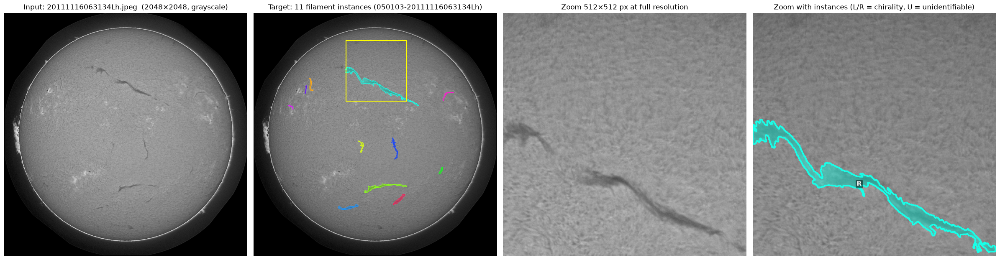
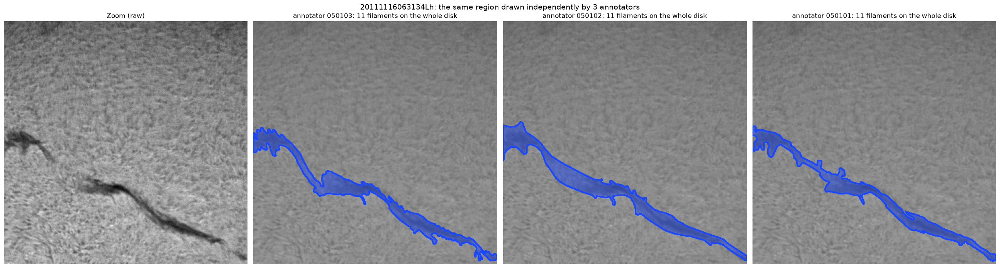
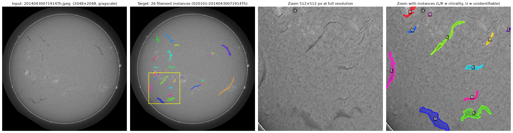

# Competition overview: task, input, and metadata

An introduction to the [Solar Filament Segmentation Challenge 2026](https://www.kaggle.com/competitions/filament-segmentation-2026):
what is being predicted, what the images look like, and what metadata comes with them.
For analysis results see [findings.md](findings.md); for prior work see [literature.md](literature.md).

## Examples

A typical image with 11 filaments. From left to right: raw input, every filament colored as its own instance, a 512 px
zoom without labels, and the same zoom with labels (L/R = chirality, U = unidentifiable).



The same zoomed region drawn independently by its 3 annotators:



The busiest training image (26 filaments, many of them small and faint):



Other images can be drawn with `python scripts/show_example.py --stem <name>` (or `--random 5`). Output goes to
`outputs/examples/`.

## What the competition is

**The science.** Filaments are clouds of cooler, denser gas held above the Sun's surface by magnetic fields. In
H-alpha light (a deep-red wavelength emitted by hydrogen) they show up as dark, thread-like streaks against the bright
disk. When one becomes unstable it can erupt into a coronal mass ejection, which affects space weather on Earth, so
solar physicists want filaments detected and outlined automatically.

**The task.** Given a full-disk image of the Sun, output one mask per filament. This is *instance* segmentation: you
don't just mark "filament pixels", you say which pixels belong to which filament. In the first figure each color is a
separate instance, and each counts separately in the score.

**The scoring.** Submissions are ranked by Panoptic Quality (PQ), explained in detail in the next section.

## How Panoptic Quality (PQ) is calculated

The leaderboard metric comes from Kirillov et al., *Panoptic Segmentation* (CVPR 2019). The details below follow the
organizers' official evaluation code (the self-evaluation notebook), which our `src/filament/metric.py` reproduces.

### Step 1: IoU between every true and every predicted filament

For a ground-truth filament *y* and a predicted filament *ŷ* (both binary masks):

$$\mathrm{IoU}(y, \hat y) = \frac{|y \cap \hat y|}{|y \cup \hat y|}$$

i.e. shared pixels divided by the pixels covered by either. For one image this gives a matrix with one row per true
filament and one column per predicted filament.

### Step 2: hits, false positives, misses

- **True positive (TP):** any (true, predicted) pair with **IoU > 0.5**.
- **False positive (FP):** a predicted filament with no TP partner.
- **False negative (FN):** a true filament with no TP partner.

### Step 3: combine over the whole test set

$$\mathrm{PQ} = \frac{\sum_{(y,\hat y) \in TP} \mathrm{IoU}(y, \hat y)}{|TP| + \tfrac12 |FP| + \tfrac12 |FN|}$$

TP, FP and FN are **pooled over all images first**, and PQ is computed once at the end. It is not an average of
per-image scores.

PQ factors into two easier-to-read parts:

$$\mathrm{PQ} = \underbrace{\frac{\sum_{TP} \mathrm{IoU}}{|TP|}}_{\text{SQ: segmentation quality}} \times \underbrace{\frac{|TP|}{|TP| + \tfrac12|FP| + \tfrac12|FN|}}_{\text{RQ: recognition quality}}$$

- **SQ** is the average IoU of the matched filaments: how well the outlines fit, ignoring misses. It is always above
  0.5, because only matches with IoU > 0.5 count.
- **RQ** is exactly the F1 score of detection: how well filaments are found, ignoring outline quality.

### Worked example

An image has 4 true filaments (A, B, C, D). The model predicts 5 objects:

| prediction | best overlap | IoU | outcome |
|---|---|---|---|
| p1 | A | 0.72 | TP |
| p2 | B | 0.61 | TP |
| p3, p4 | C, broken into two halves | 0.40, 0.35 | both FP (neither half reaches 0.5) |
| p5 | nothing | 0 | FP |
| — | D, not predicted | — | FN |
| — | C, no qualifying match | — | FN |

TP = 2 (IoU sum 1.33), FP = 3, FN = 2:

PQ = 1.33 / (2 + 1.5 + 1) = **0.296**, with SQ = 0.665 and RQ = 0.444.

If C had been predicted as one piece with IoU 0.6, it would have been TP = 3, FP = 1, FN = 1:
PQ = 1.93 / 4 = **0.483**. Fragmenting a single filament cost about 0.19.

### Specifics of this competition's implementation

1. **Scoring is per annotator-image.** Ground truth is grouped by `<annotator>-<stem>` (the part of `filament_id`
   before `_`), and each annotator's set is scored separately against your predictions for that `<stem>`. An image with
   3 annotators therefore counts 3 times, against 3 slightly different answers. The best prediction is the one the
   annotators would agree on most, not one annotator's style.
2. **No one-to-one matching step.** The original PQ assigns each true filament to at most one prediction. The official
   code simply counts every pair with IoU > 0.5. For non-overlapping masks this is the same thing, because IoU > 0.5
   makes a match unique: two disjoint predictions cannot both cover more than half of the same filament's union. Our
   predictions come from connected components, which never overlap, so this never matters for us.
3. **FP and FN cost the same** (½ each in the denominator). A spurious blob hurts exactly as much as a missed filament.
4. **Predictions for images without ground truth are ignored.** Only the images in the hidden ground truth are scored.
   Every test image is expected to have ground truth.
5. **Empty predictions for an image** make all of that image's filaments FN.
6. **Partial credit only above 0.5.** An IoU of 0.49 is worth nothing *and* adds an FP plus an FN. An IoU of 0.51 is
   worth 0.51. The score is therefore very sensitive to masks hovering around the threshold.
7. **Public vs private:** the public leaderboard is computed on about 50% of the 180 test images. The rest decides the
   private ranking, which the organizers alone see.

### Submission format

A CSV with one row per predicted filament:

```
filament_id,segmentation_rle
20150125172714Mh_1,<RLE counts>
20150125172714Mh_2,<RLE counts>
```

- `filament_id` is the image stem plus any unique suffix.
- `segmentation_rle` is the COCO compressed RLE *counts* string only (from `pycocotools.mask.encode`), without quotes.
  The size is fixed at 2048×2048.

### What this means for our models

- **Fragmentation and merging are expensive.** One filament split into two sub-0.5 pieces turns 1 TP into 2 FP + 1 FN;
  two filaments merged into one prediction usually give 1 FP + 2 FN. Connectivity matters more than in plain Dice.
- **Thin shapes are fragile.** Filaments are about 8 px wide, so a 1 px change in outline width changes IoU a lot.
  Shrinking another annotator's masks by 1 px lowers their PQ against the others from 0.34 to 0.28 (see
  [findings.md](findings.md)). The mask threshold must be tuned on validation PQ.
- **When to keep an uncertain blob.** Adding a prediction that matches with probability *p* at IoU *q* raises the
  expected PQ roughly when *p · q > ½ · PQ*. At PQ ≈ 0.4 and typical IoU ≈ 0.65, a blob is worth keeping if it is a real
  match more than about 30% of the time. This is the logic behind tuning a minimum size and confidence for components.
- **Human reference point:** annotators scored against each other reach PQ 0.34 (SQ 0.63, RQ 0.54). The organizers
  call anything above 0.35 valuable.

The final judging also reports Dice and IoU distributions and 1:n / n:1 match counts (70% quantitative, 30%
qualitative), but the leaderboard ranking uses PQ only.

## The input

- **887 JPEG images** at 2048×2048, single-channel grayscale: 707 for training and 180 for testing, without labels.
- They come from **GONG** (Global Oscillation Network Group), a network of 6 identical telescopes spread around the
  world so the Sun is always observed. The image's filename tells you which one took it.
- The images span 2011–2022, so they cover both active and quiet phases of the solar cycle.
- What the images look like:
  - The bright disk is about 1,900 px across; outside it is black.
  - The thin bright ring at the edge is the limb, with bright prominences sticking out (these are filaments seen
    side-on, but they aren't labelled).
  - The surface has a grainy "fibril" texture.
  - Bright patches are active regions around sunspots.
  - The dark streaks are the filaments.
- Filaments are only about 12% darker than the surface around them and typically about 8 px wide. In the zoom panels
  you can see how faint the smaller ones are against the texture.

## The metadata

### The filename

`YYYYMMDDHHMMSS` + site letter + `h`. For example, `20111116063134Lh` was taken on 16 Nov 2011 at 06:31:34 UTC at
Learmonth.

| Letter | Site |
|---|---|
| B | Big Bear |
| C | Cerro Tololo |
| L | Learmonth |
| M | Mauna Loa (the blurry one) |
| T | El Teide |
| U | Udaipur |

### The annotation file

`train/MAGFiLO_1.0_Annotations_kaggle2026_train.json` is in COCO format and covers the training images only. Its
three relevant parts:

**`images`:** one entry per *annotator-image*, so 1,154 entries for 707 files. The `id` looks like
`050103-20111116063134Lh`: the first 4 digits are the annotation batch and the last 2 are the annotator within it
(01–03). Each entry also has the size, the capture time and a URL to the original GONG file.

**`annotations`:** 8,199 filaments, each with:

| Field | What it is | Used by the competition? |
|---|---|---|
| `segmentation` | the filament outline as a polygon, i.e. **the training target** | yes |
| `image_id` | which annotator-image it belongs to | yes (for grouping) |
| `area`, `bbox` | size and bounding box, derived from the outline | derived |
| `category_id` | chirality: Left, Right or Unidentifiable (the L/R/U tags in the figures) | no |
| `spine` | a hand-drawn centre line along the filament | no; possibly forbidden for training (to ask the organizers) |
| `iscrowd`, `id` | COCO bookkeeping | no |

**`categories`:** the 4 chirality classes. "Ambiguous" was relabelled during review and never appears.

**Chirality** is the handedness of the filament's magnetic field. It shows in the direction its side "barbs" point, and
it's why annotators were careful about barbs on L/R filaments but drew U filaments as smooth shapes. The competition
ignores the class, but it explains why masks look so different: compare the smooth blue U blob with the frilly green L
filament at the bottom of the busiest image.

### Not provided

No labels for the test images, no exposure or quality metadata, and no magnetograms (magnetic-field maps). Everything
else has to come from the pixels.
